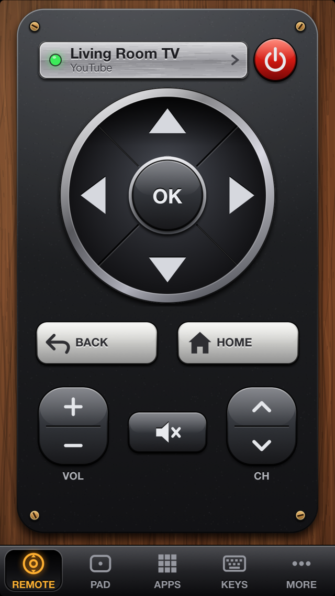
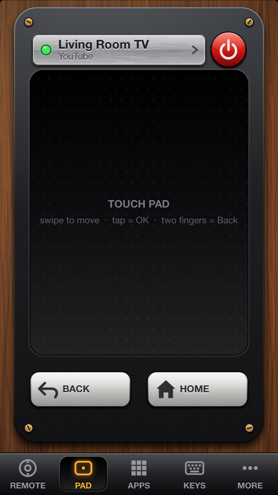
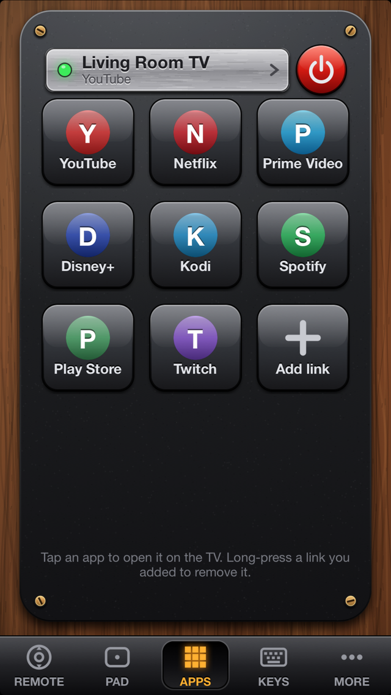
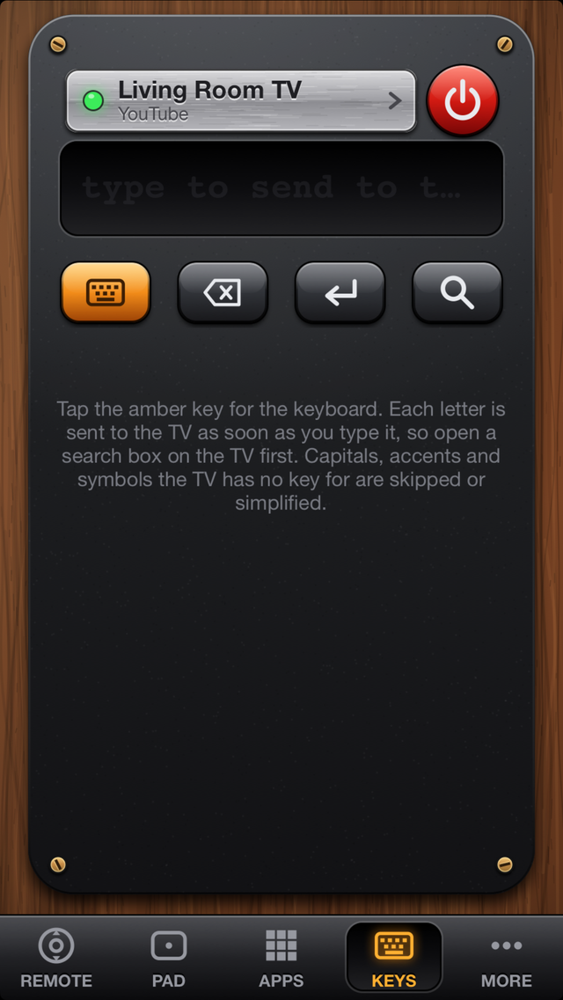
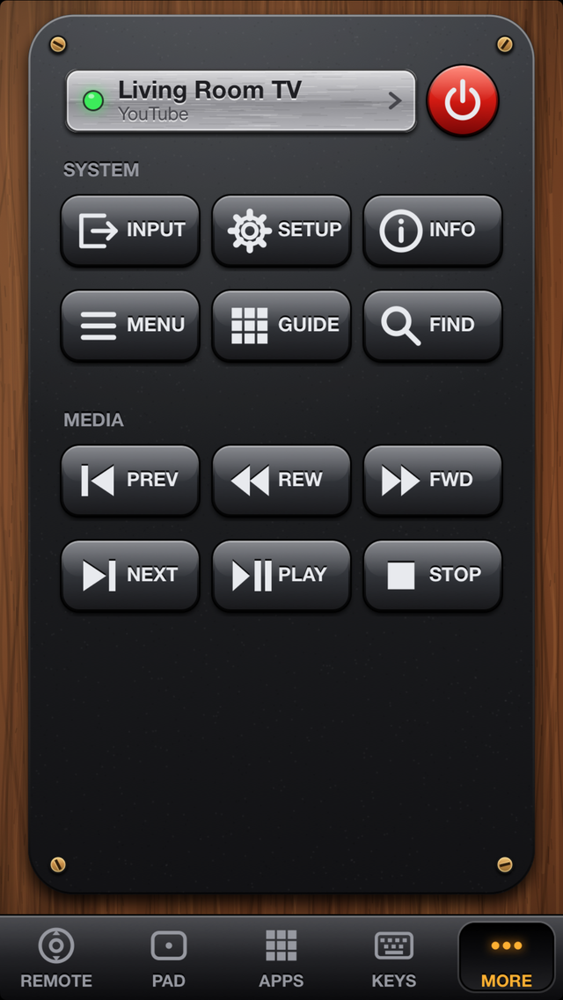

# TV Remote

A wood-and-plastic, skeuomorphic remote control for **Android TV / Google TV**, written for iPhones that are stuck on iOS 6 (developed for an iPhone 5, armv7).
It speaks the Android TV Remote protocol v2 directly from the phone, so nothing has to run on a Mac or a server while you use it.

| Remote | Pad | Apps | Keys | More |
|---|---|---|---|---|
|  |  |  |  |  |

*The screenshots come from the iOS 26 simulator build talking to `tools/mock_tv.py`, a stand-in TV with a made-up name.*

> **Status: not yet verified against a real TV.** The protocol code has been run against the mock and checked against the message definitions of the
> reference library, but the author's TV had not arrived when this was written. See [Status and limitations](#status-and-limitations). Reports from real TVs
> (with logs) are very welcome.

## Why this exists

An old iPhone makes a fine remote, but iOS 6's TLS stack cannot present a client certificate the way the Android TV protocol needs, and its crypto is far too old to
generate the keys. TV Remote therefore carries [Mbed TLS](https://github.com/Mbed-TLS/mbedtls): it creates an RSA-2048 client identity on the phone,
pairs with the TV using the 6-character code the TV shows, and then sends key events over a TLS connection on port 6466.

## Features

- **Remote** page: d-pad with OK, Back and Home keys, a volume rocker with mute, a channel rocker, and a red power key in the header. Keys fire on touch-down;
  the d-pad and rockers repeat while held (short presses, about nine per second after a 0.4 s delay); every key gives a short vibration tick.
- **Pad** page: a touch pad. Swipe to move (one arrow key per 30 points of travel), tap for OK, tap with two fingers for Back.
  The v2 protocol has no mouse pointer, so the pad only produces d-pad keys.
- **Apps** page: tiles that launch app links on the TV (YouTube, Netflix, Prime Video, Disney+, Kodi, Spotify, Play Store, Twitch), plus your own links
  (long-press one to remove it). The links are best guesses, see below.
- **Keys** page: type on the phone's keyboard; the text goes to the TV as individual key presses, with Delete, Enter and Search keys.
- **More** page: Input, Setup (settings), Info, Menu, Guide, Find (search), and the media keys (previous, rewind, forward, next, play/pause, stop).
- A brass-screwed plate at the top shows the TV's name and state (connecting, ready, the app in front, volume) and opens **Your TVs**: TVs found by Bonjour
  (`_androidtvremote2._tcp.`) and by a scan of the local /24, "Add IP", pairing, swipe to forget.
- Reconnects by itself after four seconds when the connection drops.

## Requirements

- To run it: an iOS 6 device that can install unsigned apps, i.e. jailbroken with [AppSync Unified](https://github.com/akemin-dayo/AppSync) installed;
  or the simulator on a Mac. The phone and the TV must be on the same network.
- To build it: a Mac with Xcode and its command line tools (developed with Xcode 26). Current Xcode cannot target iOS 6 by itself, so the device build links
  against the public iOS 9.3 SDK stubs, which `tools/setup-sdk.sh` downloads and patches.
- Optional: Python 3 with Pillow for `make_assets.py` (icon and launch images); Python 3 with `venv` and network access for `tests/run.sh`.

## Build and install

    tools/setup-sdk.sh                        # once: fetches and patches the iOS 9.3 SDK stubs into ./.sdk (git-ignored)
    export SDK93="$PWD/.sdk/iPhoneOS9.3.sdk"
    ./build.sh device                         # -> build/TVRemote.ipa (armv7, iOS 6.0 minimum, unsigned)
    ideviceinstaller -i build/TVRemote.ipa    # from libimobiledevice; the phone needs AppSync

`./build.sh sim` builds an arm64 simulator app, `build/sim/TVRemote.app`, with the preview hooks below:

    xcrun simctl install booted build/sim/TVRemote.app
    xcrun simctl launch booted com.savrum.tvremote

The Objective-C files are compiled with ARC but linked without it, because current Xcode has no `libarclite` for iOS 6 and the iOS 6 runtime already has the ARC entry
points the code uses. The first launch generates the RSA key in the background; on an iPhone 5 this has not been timed yet.

## First use

1. Open the app. With no TV saved it opens **Your TVs** by itself; tap **Scan**, or **Add IP** and type the TV's address.
2. Tap the TV. The TV shows a 6-character code (letters A-F and digits). Type it on the phone. A mistyped code is reported and you can try again.
3. After "Connected" the plate shows the TV's name and the remote works. Pairing is remembered by the TV.

## Simulator preview hooks

Only the simulator build (`-DTV_PREVIEW`) reads these environment variables; pass them with `SIMCTL_CHILD_<NAME>=value xcrun simctl launch ...`.

| Variable | Effect |
|---|---|
| `TV_MOCK=host[:port]` | Save that TV as the current one and connect to it (e.g. `127.0.0.1:6466` for `tools/mock_tv.py`) |
| `TV_PAGE=n` | Start on page 0 Remote, 1 Pad, 2 Apps, 3 Keys, 4 More |
| `TV_PAIR_HOST=ip[:port]` | Open the TV list and start pairing with that address |
| `TV_AUTOCODE=1` | During pairing, read the code from `/tmp/mock_tv_code` (written by the mock) and enter it automatically |

## Testing without a TV

`tools/mock_tv.py` is a stand-in TV built on the message definitions of [androidtvremote2](https://github.com/tronikos/androidtvremote2). It accepts any client
certificate, checks the pairing code the way a TV does, writes the code it shows to a file, prints every key it receives and replies with volume and app state.

    tests/run.sh

creates a Python venv under `build/`, builds the app's real networking classes (`TVPairing`, `TVRemote`, `TVLink`, `TVTLS` on Mbed TLS) natively for the Mac,
starts the mock on ports 7466/7467 and runs `tests/flowtest.m` against it: pairing (including a wrong code first), a short press, a long press (the session supports start/end key events, although the UI itself repeats short presses), an app launch and
the state updates. The script then checks what the mock saw. The UI is not covered by automated tests; CI also builds the simulator and device targets.
`tests/secret_ref.py` is a small `hashlib` reference for the pairing secret, used to cross-check the known-answer test.

## Project layout

| Path | Purpose |
|---|---|
| `src/main.m` | App delegate: identity, reconnect on launch and on becoming active, first-run TV list, preview hooks |
| `src/TVMainController.{h,m}` | The wooden body: header plate and power key, the five pages, the tab bar |
| `src/TVControls.{h,m}` | Keys, d-pad, rockers, status plate, touch pad, tab bar |
| `src/TVStyle.{h,m}` | Procedural wood and plastic drawing, glyphs, haptic tick |
| `src/TVDevicesSheet.{h,m}` | "Your TVs" panel and the pairing flow |
| `src/TVPrompt.{h,m}` | In-app replacement for `UIAlertView` (some jailbreak tweaks swallow alert views) |
| `src/TVRemote.{h,m}` | The session with a paired TV (port 6466): state, keys, long press, app links, reconnect |
| `src/TVPairing.{h,m}` | The pairing handshake (port 6467) and the secret computation |
| `src/TVLink.{h,m}` | One TLS connection carrying length-prefixed protobuf messages, with a reader thread |
| `src/TVProto.{h,m}` | Minimal protobuf encoder/parser and the Android key code constants |
| `src/TVTLS.{h,c}` | Mbed TLS client with a client certificate; RSA key and self-signed certificate generation |
| `src/TVStore.{h,m}` | Client identity and the TV list in `NSUserDefaults` |
| `src/TVDiscovery.{h,m}` | Bonjour browsing and the /24 scan for port 6466 |
| `docs/PROTOCOL.md` | The protocol as implemented here |
| `docs/ARCHITECTURE.md` | Classes, threading and the drawing approach |
| `third_party/` | Mbed TLS and its configuration (`third_party/README.md`) |
| `tools/` | `mock_tv.py`, `setup-sdk.sh` |
| `tests/` | `run.sh`, `flowtest.m`, `secret_ref.py` |
| `res/`, `make_assets.py` | Icon and launch images and the script that draws them |

## Network and privacy

There are no accounts, analytics or trackers. The app talks only to the TV you pair with (TCP 6466 and 6467 on your local network), plus Bonjour queries and,
when you tap Scan, a connection attempt to port 6466 on every address of your /24.

The app stores its client identity, including the **private key, as plain text** in its preferences (`NSUserDefaults`), together with the list of TVs and your custom
app links. Anyone with file access to the device (or to a backup of it) could use that identity to control a TV that has paired with it. The TV's own certificate is
not verified (TVs use self-signed certificates); the pairing code is what ties the connection to the right device.

## Status and limitations

- **Not tested against a real TV.** Verified: the pairing and remote protocols against `tools/mock_tv.py`, the pairing secret against a Python `hashlib` reference, and the UI in the simulator.
  Unverified guesses: the app links on the Apps page, how a given TV treats typing as key presses, and how long RSA key generation takes on an iPhone 5.
- Typing uses key presses only; the protocol's IME text API is not used, so some text fields on some TVs may not accept it.
- No mouse pointer (not part of protocol v2). No power-on while the TV is off (the TV's network stack is usually down; Wake-on-LAN is not implemented).
- The pairing hash assumes an RSA public exponent of 65537, which is what current TVs use.
- IPv4 only; one TV is active at a time.
- Developed for an iPhone 5 on iOS 6.1.3; other iOS 6 devices are untested.

## Not affiliated

TV Remote is an independent project. Android, Android TV, Google TV, Google Play and YouTube are trademarks of Google LLC; TCL, Netflix, Prime Video, Disney+, Kodi, Spotify and Twitch
are trademarks of their respective owners. They are named only to describe what the app talks to or launches. This project is not affiliated with or endorsed by any of them.

## Contributing

See [CONTRIBUTING.md](CONTRIBUTING.md). Issues and pull requests are welcome, keeping in mind that the target is iOS 6.

## License

[MIT](LICENSE) for the code in this repository. Third-party components are listed in [THIRD_PARTY_NOTICES.md](THIRD_PARTY_NOTICES.md).
